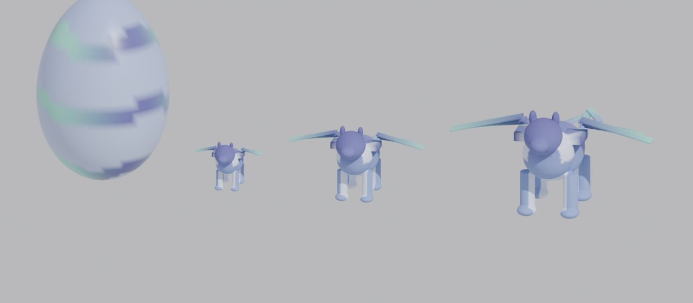

# CHAR.8 — Aurorawing: trứng thưởng, ba giai đoạn, rig và animation

> **Trạng thái:** blockout **SAMPLE** để duyệt tỉ lệ, bảng màu và rig — **không phải art cuối, chưa nghiệm thu**. Đã chạy thật bằng Blender 5.3 (`bpy`) qua đúng pipeline batch (prepare → rig_archetype → LOD → animation QA). **Chưa chạy trong Unity.**
> Luật trao trứng (sau 15 chuyến thám hiểm Thiên Giới) thuộc Domain, đang ở dạng đề xuất (ADR 0207, `Docs/u2.12/SKY_CLOUD_PROPOSAL.md`). Phần Character không đọc hay đổi luật đó.



## 1. Dữ liệu canonical (không đổi)

| Trường | Giá trị (nguồn `species-character-spec.json`) | Hệ quả cho asset |
|---|---|---|
| Locomotion | walk, fly | archetype **winged**: Walk/Run + Fly/TakeOff/Glide/Land; **không** Swim, Burrow |
| Bề mặt / hô hấp | fur / lung | material mờ (roughness 0,85); có Bask (thở phổi) |
| BodyStyle | Winged | có xương `Wing_L/R` (Upper, Fore, Tip) |
| Silhouette | "Cánh dải sáng, lông cổ, đuôi cực quang" | cánh gồm các dải màng song song; cổ có vòng lông; đuôi kết thúc bằng các dải sáng xòe |
| Bảng màu | primary `#879BD5`, secondary `#5F5B9E`, belly `#DDE6FA`, accent `#8DE6CF` | lưng primary → secondary; bụng và lông cổ belly; cánh secondary chuyển sang accent ở mép (cực quang); dải đuôi accent |
| Hoạt động | night | không đổi animation; planner hiện hành dùng nhịp ngày đêm |
| Thời gian trưởng thành | 180 phút, Juvenile từ 3 780 s | mốc đổi model Baby → Juvenile → Adult do Domain quyết định |
| Chân đậu | silhouette **không** ghi "chân đậu" | **không** có clip Perch (luật `build_archetypes.py`) |

## 2. Đề xuất (art director phải xác nhận)

| Mục | Đề xuất | Lý do |
|---|---|---|
| Số chân | 4 (rig bằng `limbCount: "auto"`, đo được 4 chân, độ tin cậy cao) | GDD chưa ghi; giống các loài bay khác trong mẫu |
| Chiều cao | Baby 0,55 m · Juvenile 0,85 m · Adult 1,20 m | Emberling 0,90 m; Aurorawing là Epic, lớn hơn khi trưởng thành |
| Tỉ lệ đầu | Baby ×1,20 · Juvenile ×1,12 · Adult ×1,00 | rồng con đầu to; ×1,30 làm cổ giãn quá ngưỡng ở Eat/Drink/Sleep (QA), nên giảm còn ×1,20 |
| Sải cánh | Baby 0,70 m · Juvenile 1,41 m · Adult 2,12 m | cánh dài dần theo tuổi; mọi giai đoạn vẫn có đủ clip bay vì sinh học không phân theo giai đoạn (câu hỏi mở 1) |
| Dải đuôi | 1 / 2 / 3 | "đuôi cực quang" dày dần |
| Thế đứng Adult | rộng hơn (±0,17 so với ±0,14 đơn vị blockout) | xem phát hiện P1 ở mục 5 |
| Trứng | ô-van, đáy rộng, 0,15 × 0,22 m, nền belly → primary, 4 dải secondary → accent uốn sóng, bóng (roughness 0,35) | trứng thưởng Normal (không đột biến), đọc được trên Sanctuary |

## 3. Kết quả pipeline (Blender 5.3, thật)

| Asset | Trạng thái batch | Rig | Clip | LOD tris | Bone | Animation QA |
|---|---|---|---|---|---|---|
| `DRG_aurorawing_Baby` | ok_with_notes (limbCount auto) | winged | 19 | 24 000 / 10 000 / 4 000 | 32 | **PASS** |
| `DRG_aurorawing_Juvenile` | ok_with_notes (limbCount auto) | winged | 19 | 24 000 / 10 000 / 4 000 | 32 | **PASS** |
| `DRG_aurorawing_Adult` | ok_with_notes (limbCount auto) | winged | 19 | 24 000 / 10 000 / 4 000 | 32 | **PASS** |
| `PRP_egg_aurorawing` | ok | — (prop, nhóm `egg`, collider convex 250 tris) | — | 2 500 / 900 / 300 (prop_small) | — | validation PASS |

Clip (theo archetype, không thêm khả năng): Idle, Eat, Sleep, Happy, Walk, Run, Fly, Rest, Wake, LookAround, Curious, Drink, Stretch, Bask, Greet, Nuzzle, TakeOff, Glide, Land.

QA chính (ngưỡng không đổi: giãn p99,9 ≤ 1,6; trượt chân, xuyên đất ≤ 0,01; cánh trong thân ≤ 0,002):

| Giai đoạn | Giãn lớn nhất (clip) | Trượt chân Walk | Xuyên đất lớn nhất (clip) | Cánh trong thân | Sai lệch chuyển tiếp lớn nhất |
|---|---|---|---|---|---|
| Baby | 1,555 (Drink) | 0,0002 | 0,0081 (Land) | 0 | 0,04° |
| Juvenile | 1,485 (Drink) | 0 | 0,0090 (Land) | 0 | 0,04° |
| Adult | 1,517 (Drink) | 0,0001 | 0,0095 (Land) | 0 | 0,069° |

Chuyển tiếp được kiểm: Sleep → Wake → Idle, Idle → TakeOff → Fly → Land → Idle. Sự kiện: `TakeOff.liftOff` 0,323, `Land.touchDown` 0,6. Tốc độ đi (Froude): Baby 0,145 · Juvenile 0,180 · Adult 0,217 m/s.

Báo cáo đầy đủ: `scripts/art/character/reports_char8_sample/aurorawing/` (qa/, prefab-catalog, animation-report, motion-report, performance-budget, batch-report).

## 4. Tái tạo

```bash
python scripts/art/character/make_aurorawing_review.py <src>          # với module bpy 5.3 (hoặc blender --background --python … -- <src>)
python scripts/art/character/batch_import.py <src> <work> --bpy-module --qa-images \
    --overrides Assets/Dravio/Character/Data/asset-overrides.char8-local.json
python scripts/art/character/build_character_reports.py <work> <reports>
```

Unity (chưa chạy): `batch_import.py … --unity-out Assets/Dravio/Character/Imported` rồi **Dravio ▸ Character ▸ Import Batch Manifest**; xem trong **Animation Lab**. Tên `SAMPLE_*` luôn được báo cáo là SAMPLE; không đưa vào `approved-assets.json`.

Khi có model thật (Hunyuan GLB `aurorawing_Baby/Juvenile/Adult.glb`): chạy cùng lệnh batch; nếu cánh thật dài hơn thân, xem P1.

## 5. Phát hiện và câu hỏi mở

- **P1 (pipeline):** `rig_geometry.ground_clusters` chia lưới theo 2,5 % đường chéo của **cả** mô hình. Với loài bay có sải cánh lớn, ô lưới to tới mức hai bàn chân trái/phải dính thành một cụm giữa thân → `limbCount: "auto"` bị từ chối và rig không được tạo. Blockout tránh bằng thế đứng rộng hơn. Model thật có thể gặp lại: khi đó dùng `files.<stem>.landmarks.feet` trong override, hoặc (đề xuất cho pipeline kế tiếp) tính ô lưới theo phần thân gần mặt đất thay vì cả mô hình. Không sửa trong CHAR.8 để không đổi kết quả của 7 model đã chạy.
- **Câu hỏi 1:** rồng con (Baby) có bay được không? Dữ liệu canonical không phân khả năng theo giai đoạn nên mọi giai đoạn đều có clip bay. Nếu GDD muốn Baby chỉ đi bộ, cần luật ở Domain (không phải ở animation).
- **Câu hỏi 2:** số chân, chiều cao, tỉ lệ ba giai đoạn và thiết kế trứng ở mục 2.
- **Câu hỏi 3:** bảng màu cực quang có cần phát sáng (emission) ở mép cánh không? Blockout chỉ dùng màu nền.
