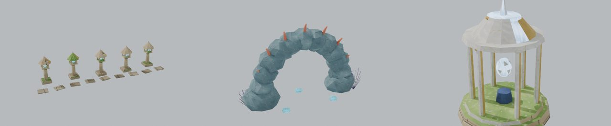

# CHAR.8 — Sanctuary project prefab catalog

> Nguồn danh mục: Domain `SanctuaryProjectContent` (20 công trình) và `Docs/u2.11/SANCTUARY_PROJECTS.md`. Tài liệu này chỉ về **hình ảnh**: không quyết định giá, vật liệu xây, buff hay phần thưởng (Domain sở hữu).
> **Trạng thái:** 3 **mẫu phong cách** (mỗi thế giới một) để duyệt trước khi sản xuất 17 công trình còn lại. Đã dựng và render thật bằng Blender 5.3; **chưa import vào Unity**.



## 1. Nguyên tắc

- **Cùng bộ kit môi trường:** dựng bằng `Kit` của `build_origin_sanctuary.py` / `build_zone_kits.py`, UV vào đúng atlas painterly của từng thế giới. **Không thêm texture hay material**: prefab dùng lại `M_ENV_Props` (Khởi Nguyên), `M_ENV_Ocean_Props` / `M_ENV_Ocean_Foliage` (Thủy Vực), `M_ENV_Sky_Props` (Thiên Giới). Draw call thêm mỗi công trình: 1–2, cùng material với cảnh nên SRP Batcher gộp được.
- **Pivot** đáy giữa (mặt đất y = 0); **mặt trước** −Z (hướng camera Sanctuary) như mọi prop môi trường.
- **LOD:** 3 mức trong một FBX (`_LOD0/1/2`, tỉ lệ 1 / 0,5 / 0,22), chuyển ở 0,35 / 0,12 / 0,02 chiều cao màn hình. Ngân sách LOD0 ≤ 6 000 tam giác (đề xuất; cảnh Sanctuary 60 000).
- **Anchor:** empty `ANCHOR_*` xuất trong FBX, vị trí ghi lại trong JSON theo tọa độ Unity. `Approach` = chỗ rồng đứng ngắm công trình; `VFX_Complete` = hiệu ứng khi xây xong; `Light_n`, `Glow_n`, `Crystal`, `Perch_n`, `SwimThrough` theo kiểu công trình.
- **Collider:** BoxCollider theo bounds (công trình là trang trí, không chặn đường đi chính; vùng chiếm chỗ dùng `footprintRadius_m`).
- **Biến thể kiểu dáng** từ mẫu trang trí (`blueprint.*`, 5 công trình): prefab biến thể `PF_SANC_<id>_Variant`, cùng anchor; chưa làm.

## 2. Danh mục 20 công trình

| # | projectId | Tên (nháp) | Thế giới | Kiểu | Prefab ID | Model | Material (dùng lại) | Trạng thái | LOD tris | Kích thước Unity (x·y·z m) | Anchor |
|---|---|---|---|---|---|---|---|---|---|---|---|
| 1 | `origin_mossy_steps` | Bậc đá rêu phong | Khởi Nguyên | path | `PF_SANC_origin_mossy_steps` | `SM_SANC_origin_mossy_steps.fbx` | M_ENV_Props | kế hoạch | ≤ 6000 LOD0 | — | Approach, PathStart, PathEnd, VFX_Complete |
| 2 | `origin_lantern_row` | Hàng đèn đá dẫn lối | Khởi Nguyên | light | `PF_SANC_origin_lantern_row` | `SM_SANC_origin_lantern_row.fbx` | M_ENV_Props | **mẫu phong cách** | 1856/928/408 | 7.76·1.66·1.57 | Approach, Light_0, Light_1, Light_2, Light_3, Light_4, VFX_Complete |
| 3 | `origin_meadow_arbor` | Giàn hoa đồng cỏ | Khởi Nguyên | garden | `PF_SANC_origin_meadow_arbor` | `SM_SANC_origin_meadow_arbor.fbx` | M_ENV_Props | kế hoạch | ≤ 6000 LOD0 | — | Approach, Rest_n (chỗ nằm), VFX_Complete |
| 4 | `origin_trail_shrine` | Miếu nhỏ bên lối mòn | Khởi Nguyên | landmark | `PF_SANC_origin_trail_shrine` | `SM_SANC_origin_trail_shrine.fbx` | M_ENV_Props | kế hoạch | ≤ 6000 LOD0 | — | Approach, VFX_Complete, (Perch_n nếu có chỗ đậu) |
| 5 | `origin_lily_pond` | Ao sen bờ hồ | Khởi Nguyên | water | `PF_SANC_origin_lily_pond` | `SM_SANC_origin_lily_pond.fbx` | M_ENV_Props | kế hoạch | ≤ 6000 LOD0 | — | Approach, Drink_n / SwimThrough, VFX_Complete |
| 6 | `origin_rune_circle` | Vòng đá rune | Khởi Nguyên | light | `PF_SANC_origin_rune_circle` | `SM_SANC_origin_rune_circle.fbx` | M_ENV_Props | kế hoạch | ≤ 6000 LOD0 | — | Approach, Light_n, VFX_Complete |
| 7 | `origin_ancient_gate` | Cổng đá cổ phục dựng | Khởi Nguyên | landmark | `PF_SANC_origin_ancient_gate` | `SM_SANC_origin_ancient_gate.fbx` | M_ENV_Props | kế hoạch | ≤ 6000 LOD0 | — | Approach, VFX_Complete, (Perch_n nếu có chỗ đậu) |
| 8 | `origin_elder_statue` | Tượng rồng tổ | Khởi Nguyên | landmark | `PF_SANC_origin_elder_statue` | `SM_SANC_origin_elder_statue.fbx` | M_ENV_Props | kế hoạch | ≤ 6000 LOD0 | — | Approach, VFX_Complete, (Perch_n nếu có chỗ đậu) |
| 9 | `ocean_tide_pools` | Vũng triều | Thủy Vực | water | `PF_SANC_ocean_tide_pools` | `SM_SANC_ocean_tide_pools.fbx` | M_ENV_Ocean_Props (+ Foliage) | kế hoạch | ≤ 6000 LOD0 | — | Approach, Drink_n / SwimThrough, VFX_Complete |
| 10 | `ocean_coral_arch` | Vòm san hô | Thủy Vực | landmark | `PF_SANC_ocean_coral_arch` | `SM_SANC_ocean_coral_arch.fbx` | M_ENV_Ocean_Props (+ Foliage) | **mẫu phong cách** | 2028/1014/446 | 5.9·3.74·1.74 | Approach, Glow_0, Glow_1, Glow_2, Glow_3, Glow_4, Glow_5, Glow_6, SwimThrough, VFX_Complete |
| 11 | `ocean_shell_path` | Lối vỏ sò | Thủy Vực | path | `PF_SANC_ocean_shell_path` | `SM_SANC_ocean_shell_path.fbx` | M_ENV_Ocean_Props (+ Foliage) | kế hoạch | ≤ 6000 LOD0 | — | Approach, PathStart, PathEnd, VFX_Complete |
| 12 | `ocean_kelp_garden` | Vườn tảo bẹ | Thủy Vực | garden | `PF_SANC_ocean_kelp_garden` | `SM_SANC_ocean_kelp_garden.fbx` | M_ENV_Ocean_Props (+ Foliage) | kế hoạch | ≤ 6000 LOD0 | — | Approach, Rest_n (chỗ nằm), VFX_Complete |
| 13 | `ocean_glow_buoys` | Phao phát sáng | Thủy Vực | light | `PF_SANC_ocean_glow_buoys` | `SM_SANC_ocean_glow_buoys.fbx` | M_ENV_Ocean_Props (+ Foliage) | kế hoạch | ≤ 6000 LOD0 | — | Approach, Light_n, VFX_Complete |
| 14 | `ocean_sunken_shrine` | Đền chìm | Thủy Vực | landmark | `PF_SANC_ocean_sunken_shrine` | `SM_SANC_ocean_sunken_shrine.fbx` | M_ENV_Ocean_Props (+ Foliage) | kế hoạch | ≤ 6000 LOD0 | — | Approach, VFX_Complete, (Perch_n nếu có chỗ đậu) |
| 15 | `sky_cloud_bridge` | Cầu mây | Thiên Giới | path | `PF_SANC_sky_cloud_bridge` | `SM_SANC_sky_cloud_bridge.fbx` | M_ENV_Sky_Props | kế hoạch | ≤ 6000 LOD0 | — | Approach, PathStart, PathEnd, VFX_Complete |
| 16 | `sky_cloud_garden` | Vườn trên mây | Thiên Giới | garden | `PF_SANC_sky_cloud_garden` | `SM_SANC_sky_cloud_garden.fbx` | M_ENV_Sky_Props | kế hoạch | ≤ 6000 LOD0 | — | Approach, Rest_n (chỗ nằm), VFX_Complete |
| 17 | `sky_wind_chimes` | Chuông gió | Thiên Giới | light | `PF_SANC_sky_wind_chimes` | `SM_SANC_sky_wind_chimes.fbx` | M_ENV_Sky_Props | kế hoạch | ≤ 6000 LOD0 | — | Approach, Light_n, VFX_Complete |
| 18 | `sky_falling_spring` | Suối rơi | Thiên Giới | water | `PF_SANC_sky_falling_spring` | `SM_SANC_sky_falling_spring.fbx` | M_ENV_Sky_Props | kế hoạch | ≤ 6000 LOD0 | — | Approach, Drink_n / SwimThrough, VFX_Complete |
| 19 | `sky_star_observatory` | Đài ngắm sao | Thiên Giới | landmark | `PF_SANC_sky_star_observatory` | `SM_SANC_sky_star_observatory.fbx` | M_ENV_Sky_Props | **mẫu phong cách** | 856/428/188 | 3.12·4.0·4.1 | Approach, Crystal, Perch_0, Perch_1, VFX_Complete |
| 20 | `sky_aurora_spire` | Tháp cực quang | Thiên Giới | landmark | `PF_SANC_sky_aurora_spire` | `SM_SANC_sky_aurora_spire.fbx` | M_ENV_Sky_Props | kế hoạch | ≤ 6000 LOD0 | — | Approach, VFX_Complete, (Perch_n nếu có chỗ đậu) |

Anchor ghi "kế hoạch" là bộ tối thiểu theo kiểu công trình; con số chính xác chỉ có sau khi dựng.

## 3. Tái tạo và tích hợp

```bash
# Blender 5.3 hoặc module bpy 5.3; --unity chỉ chép file CHƯA có (không ghi đè)
python scripts/art/environment/build_sanctuary_projects.py -- --out art-exports/sanctuary \
    --unity Assets/Dravio/Environment/Sanctuary --preview
```

Đầu ra: `Assets/Dravio/Environment/Sanctuary/Models/SM_SANC_<id>.fbx`, `Data/<id>.sanctuary.json` (prefabId, materials, LOD, bounds, footprint, anchors), `Data/SanctuarySamplesManifest.json`.

Trong Unity (chưa chạy trong môi trường tác giả):

1. Chạy **Dravio ▸ Environment ▸ 1. Setup Materials** và **Ocean / Sky Setup** để có `M_ENV_*` (công cụ cũ).
2. **Dravio ▸ Environment ▸ Sanctuary ▸ Build Project Style-Sample Prefabs**: tạo `Sanctuary/Prefabs/PF_SANC_<id>.prefab` (LODGroup, BoxCollider, static flags, `SanctuaryProjectVisual` với anchor). Prefab đã có thì giữ nguyên.
3. Tầng tích hợp Sanctuary: với mỗi `SanctuaryProjects(s)` có `Built = true`, lấy prefab có `projectId` khớp, đặt tại slot của `DisplayZoneId`; công trình đang chờ (`Built = false`) có thể hiện ghost. `SanctuaryProjectVisual.TryGetAnchor("Approach", out t)` cho điểm rồng tới ngắm; `VFX_Complete` cho hiệu ứng khi nhận event `sanctuaryProjectBuilt`.
4. Commit FBX + `.meta` do Unity sinh sau khi kiểm tra bằng mắt (quy ước thư mục Environment).

## 4. Cần duyệt trước khi sản xuất 17 công trình còn lại

- Phong cách: mức chi tiết, độ "cổ" (rêu, nứt), màu vàng trang trí, độ phát sáng.
- Tỉ lệ so với rồng (Emberling 0,9 m; Aurorawing Adult đề xuất 1,2 m): hàng đèn 1,66 m, vòm san hô 3,74 m, đài ngắm sao 4,0 m.
- Vị trí slot của từng công trình trong layout Sanctuary (chưa có trong Domain hay Environment).
