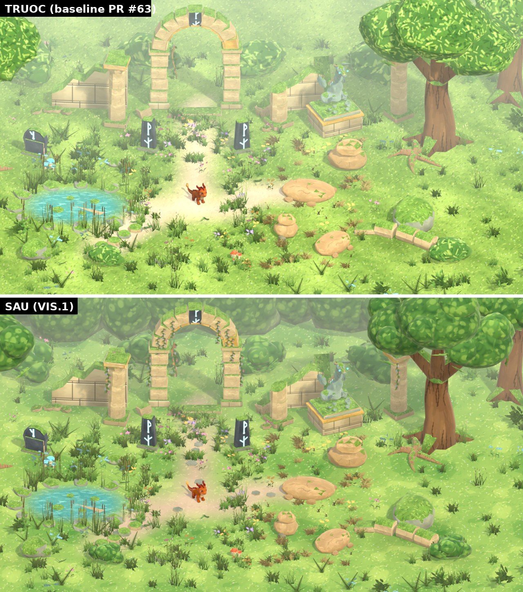
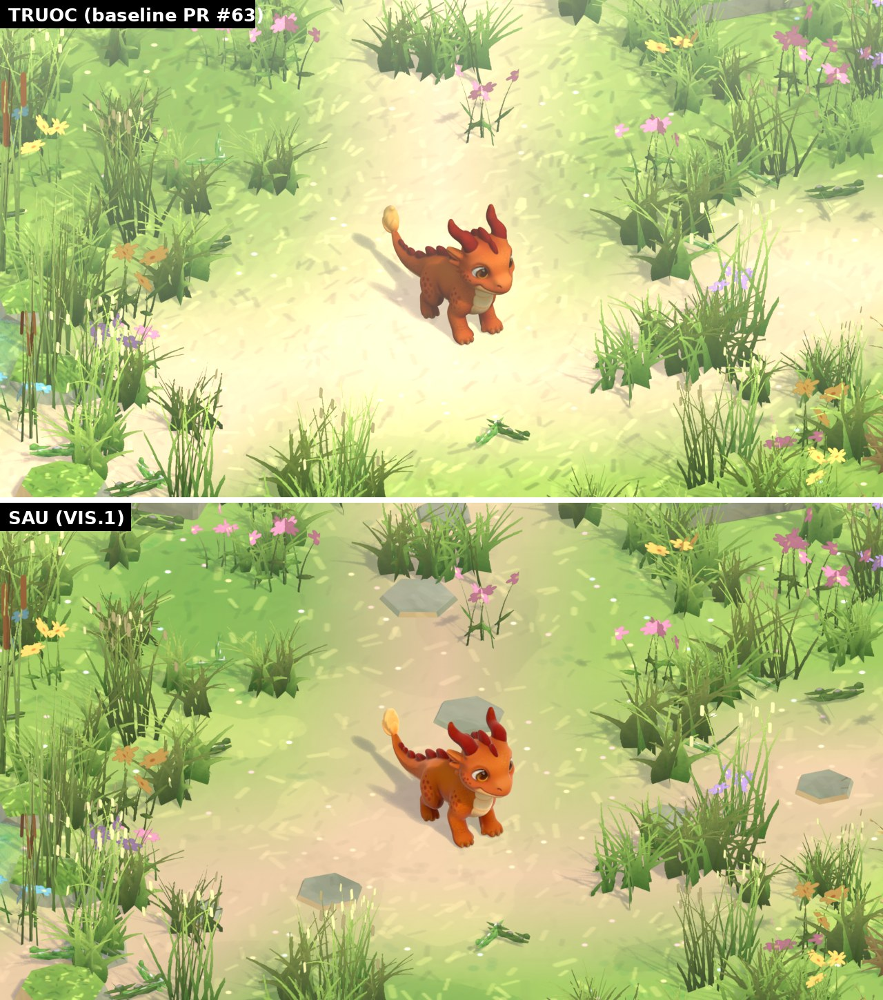
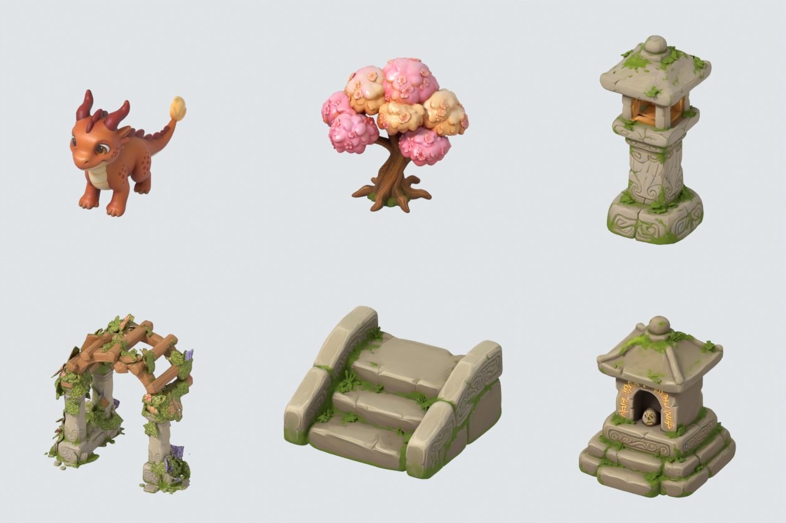

# VIS.1 — Khởi Nguyên + Emberling: mẫu đồ họa Ancient Fantasy (Issue #80)

Nhánh `claude/project-thread-bugtzu`, tách từ đầu PR #63 (`6eb1295`, gồm baseline `83dddeb` mà Issue #80 chỉ định). PR này nhắm vào nhánh của #63, không phải `main`, vì scene Khởi Nguyên chơi được (`OriginLongTermGameplay*`) chỉ có trong #63. Phạm vi: chỉ Khởi Nguyên và Emberling. Thủy Vực / Thiên Giới **không đổi** (có test bảo vệ).

## Mức bằng chứng (đọc trước)

| Hạng mục | Trạng thái |
|---|---|
| Sinh asset bằng Blender 5.3 (`bpy` 5.3.0) | **Đã chạy thật** trong môi trường này |
| Ảnh trước/sau | **Render Blender EEVEE** (Vulkan/lavapipe), cùng camera, cùng layout, cùng ánh sáng 13:00 của từng phiên bản, vật liệu mô phỏng shader `Painterly Lit`. **Không phải ảnh chụp Unity** |
| Unity Editor, compile shader/C#, Play Mode, Frame Debugger | **NOT RUN** (không có Unity trong môi trường) |
| Android / thiết bị | **NOT RUN** |
| Test Python (môi trường + VIS.1) | 90 test môi trường cũ + 9 test VIS.1 **PASS** |

Ảnh chụp Unity trước/sau cần chủ dự án làm theo mục "Nghiệm thu trong Unity" bên dưới.

## Ảnh trước / sau (Blender, cùng góc camera Unity)





Thêm: [20:9](images/compare_20x9.jpg), ảnh đơn trong `images/`.

## 1. Kiểm kê ArtSource (đã kiểm thật bằng Blender)

Công cụ: `scripts/art/vis1/audit_artsource.py` → [artsource_audit.json](artsource_audit.json). 22 GLB, **tất cả** cùng dạng image-to-3D: 1 mesh, đúng 40 000 tam giác, 1 material, 2 ảnh 2048², không rig, không animation, chuẩn hóa ~2 m.

| GLB | Dùng cho Khởi Nguyên? | Kết luận |
|---|---|---|
| `Dragons/01_emberling.glb` | Có | Đã là nguồn của `EmberlingRefinedGLB.fbx` (CHAR.9, 24k tam giác, rig v7). VIS.1 nâng shading, không đụng mesh/rig (animation thuộc #76/#78) |
| `SanctuaryProjects/origin/origin_lantern_row.glb`, `origin_meadow_arbor.glb`, `origin_mossy_steps.glb`, `origin_trail_shrine.glb` | Có, nhưng là **công trình Sanctuary** (xây bằng gameplay) | Chất lượng tốt, đúng phong cách (xem ảnh). **Không** đặt làm đồ trang trí tĩnh: sẽ hiện trước khi người chơi xây, sai hợp đồng gameplay. Đề xuất VIS.1b: giảm còn ≤ 6 000 tam giác LOD0 + LOD1/2, bake texture 1024², thay `SM_SANC_origin_lantern_row.fbx` (giữ GUID, anchor) và tạo 3 prefab còn lại |
| `NatureAndGameplay/foliage/02_tree_blossom_sky.glb` | Không | Cây hoa của Thiên Giới; để dành khi nhân rộng |
| `SanctuaryProjects/blueprints/blueprint.cloud_garden.glb` | Không | Thiên Giới |
| 15 rồng còn lại | Không (ngoài phạm vi) | |



Concept dùng làm tham chiếu: `Habitats/concepts/01_origin_meadow.jpg`, `02_origin_warm_rocks.jpg`, `03_origin_pondbank.jpg`, `props_3d/*`.

## 2. Định hướng phong cách (Stylized 3D Ancient Fantasy)

Rút từ concept Origin:
- **Hình khối đọc được ở màn hình điện thoại**: tán cây là cụm "mây" tròn có sáng/tối riêng từng cụm, không phải khối bọt có vằn rằn ri.
- **Ấm/lạnh**: nắng vàng ấm, bóng xanh tím mát, trời mát, phản xạ đất ấm.
- **Địa danh chính**: cổng đá phủ dây leo nở hoa (hồng, vàng, trắng, lam) như concept; cột đá có hoa trên đỉnh.
- **Lối đi có thiết kế**: đất nâu ấm + đá lát lục giác rời rạc dẫn từ bãi trống ra cổng, ao và đá ấm.
- **Chiều sâu**: dải rừng nền mềm sau phế tích, sương ấm làm mờ dần thay vì bãi cỏ trống ở mép trên màn hình.
- **Rồng là tâm điểm**: cùng mô hình sáng với môi trường + viền sáng ấm để tách khỏi cỏ.

## 3. Đã thay đổi

### Khởi Nguyên (Origin)
Tất cả trong `scripts/art/environment/build_origin_sanctuary.py`, mục `VIS.1 ORIGIN OVERHAUL`. Các builder U1-ENV cũ giữ nguyên vì Ocean/Sky và Sanctuary dùng lại.

| Asset (cùng tên, cùng GUID) | Trước → Sau (tam giác / ngân sách) | Thay đổi |
|---|---|---|
| `SM_ENV_Tree_Ancient` | 2 216 → 3 344 / 3 600 | Tán 4 khối → 4 lõi + 16 cụm, ánh sáng sơn theo từng cụm (vertex AO `vis_ao`) |
| `SM_ENV_Tree_Ancient_B` | 1 496 → 2 450 / 3 000 | Như trên |
| `SM_ENV_Shrub_Round` | 252 → 422 / 1 500 | 5 cụm có sáng/tối + nhánh hoa |
| `SM_ENV_Gate_Ancient` | 1 164 → 1 204 / 2 600 | Rèm dây leo nở hoa, hoa trên đầu cột |
| `SM_ENV_Column_Intact` | 244 → 250 / 1 500 | Dây leo + hoa |
| `SM_ENV_Ground_Sanctuary` | 2 160 → 2 440 / 2 600 | Đá lát dọc 3 lối đi (cao 3,5 cm, nằm trong vùng phẳng) |
| `SM_ENV_Cover_Edges` | 1 204 → 2 564 / 3 000 | Dải rừng nền z 12,6–14,8 m (ngoài FLAT_RECT, không collider) |
| **Cả cảnh** | **26 306 → 33 352 / 60 000**, 45 placement (không đổi) | |

Texture (`painterly_textures.py`, cùng kích thước, cùng GUID): ô atlas `leaf_canopy` mới (khối lá tròn, bỏ vằn), `T_ENV_Ground` mới (mảng sáng/tối lớn, cỏ ba lá, ít nét tối), ô foliage `ivy_strand` thêm hoa. Mọi ô atlas và ô foliage khác **giống từng bit** bản cũ (đã so).

Ánh sáng (`living.py`, `OriginSanctuaryLiving.json/.asset`, builder, scene `OriginLongTermGameplay_Environment.unity`):
- 13:00: nắng (1,0; 0,86; 0,66) × 1,12; trời (0,56; 0,66; 0,84); xích đạo (0,50; 0,56; 0,48); đất (0,34; 0,28; 0,22); sương (0,80; 0,84; 0,70). Hướng nắng **giữ nguyên** (46°, −38°).
- 8:00 và 16:30 giảm cùng tỉ lệ để không nhảy sáng. Bản cũ cộng nắng 1,35 + ambient ~0,8 làm cỏ và đá sáng gần trắng; tổng ánh sáng ban ngày nay thấp hơn ~25 %.
- Sương tuyến tính 24–52 m → 28–64 m: cổng và tượng rõ hơn, rừng nền vẫn mờ.
- Đêm, bình minh, hoàng hôn: không đổi. Ocean/Sky giữ ngày U1-ENV.2 qua `living.U1_ENV2_KEYFRAMES`.

Vật liệu `M_ENV_Props/Foliage/Ground` (shader cũ, chỉ đổi giá trị): bóng (0,56; 0,62; 0,90), ramp 0,02 ± 0,26, rim ấm 0,22, lối đi (0,50; 0,38; 0,25), emission rune 2,0. Builder ghi cùng giá trị qua `ApplyOriginVis1Grade` (chỉ Origin).

### Emberling
- Shader mới `Assets/Dravio/Art/Shaders/DravioCharacterStylized.shader` (`Dravio/Character/Stylized Lit`): cùng mô hình ramp/bóng mát/ambient như môi trường, rim ấm, highlight mềm. URP 17, chỉ main light, 1 texture, SRP Batcher, có ShadowCaster + DepthOnly, chạy với SkinnedMeshRenderer.
- Menu **Dravio ▸ Visual ▸ VIS.1 Apply Stylized Emberling Material**: tạo `Art/Materials/M_CHR_Emberling_Stylized.mat` (lấy base map của material nhập từ FBX) và gán làm override trong `EmberlingRefinedGLBVisual.prefab`. **Revert** gỡ override. Không đụng FBX, mesh, bone, Animator, collider, transform. Chưa chạy vì không có Unity: prefab trong PR **vẫn y nguyên**, chủ dự án chạy menu sau khi shader compile.

## 4. Hợp đồng được giữ

- `OriginSanctuaryLayout/Locations/Colliders.json` và `.asset`: không đổi (test hash U1-ENV.2 cũ vẫn PASS). Spawn, transition, perch, điểm tương tác, vùng bơi, collider: không đổi.
- GUID: không file `.meta` nào thay đổi (test `test_guids_and_gameplay_data_unchanged_since_baseline`). FBX/PNG ghi đè tại chỗ. Prefab `SM_ENV_*` là model prefab nên tự nhận slot material mới; remap 4 material có sẵn trong mọi `.fbx.meta`.
- `OriginLongTermGameplay.unity`, prefab Emberling, FBX Emberling, Domain, save, UI, camera gameplay: không đổi.
- Ngân sách mobile: 33 352 / 60 000 tam giác, ≤ 3 material mỗi asset, texture giữ kích thước + ASTC cũ. Draw call ước tính tăng ≤ 4 batch (Gate/Column thêm Foliage, Ground/Cover_Edges thêm Props, cùng material với cảnh nên SRP Batcher/static batching gộp); **chưa đo** bằng Frame Debugger.

## 5. Nghiệm thu trong Unity (chủ dự án)

1. **Ảnh "trước"**: checkout đầu PR #63 (`6eb1295`), mở `OriginLongTermGameplay`, Game view 16:9 và 20:9, chụp; Play, chọn Emberling, inspect/follow, chụp.
2. Checkout nhánh này, để Unity import lại (7 FBX, 3 PNG, 3 material, 1 shader mới). Console không lỗi đỏ, shader `Dravio/Character/Stylized Lit` không hồng.
3. **Dravio ▸ Visual ▸ VIS.1 Apply Stylized Emberling Material**.
4. Chụp lại đúng các góc ở bước 1 ("sau"). Không cần chạy lại Build Everything: scene và material đã được cập nhật trong PR.
5. Kiểm: Frame Debugger (batch trước/sau), **Report Mobile Budget**, Play 2 phút xem gió lá, dây leo, Emberling idle/walk (animation vẫn thuộc #76/#78), đổi giờ 6:00/13:00/18:30/22:00 trên Environment Time Of Day.
6. Không ưng phần nào: Revert menu cho Emberling; với môi trường, revert file tương ứng (mỗi asset độc lập).

## 6. Chưa làm / đề xuất bước sau

- VIS.1b: chuyển 4 GLB công trình Origin thành prefab Sanctuary (LOD, ≤ 6 000 tam giác) — cần duyệt vì đụng `SM_SANC_origin_lantern_row` hiện có.
- Hiệu ứng: tia nắng xuyên tán (card alpha, như Ocean), đom đóm ban ngày → bụi phấn hoa; volume hậu kỳ (tonemapping) chỉ khi đo được chi phí trên Android.
- Tượng rồng: chưa đổi khối (concept có cánh mở rộng hơn).
- Nhân rộng Thủy Vực / Thiên Giới: chỉ sau khi chủ dự án duyệt mẫu này.

## Tái tạo

```bash
# Blender 5.3 hoặc pip install bpy==5.3.0
python scripts/art/environment/build_origin_sanctuary.py -- --out art-exports/environment
# chỉ chép 7 FBX + 3 PNG + manifest đã liệt kê ở trên vào Assets/Dravio/Environment (FBX khác không đổi hình học)
VK_ICD_FILENAMES=/opt/lavapipe/lvp_icd.json python scripts/art/vis1/render_origin_slice.py -- \
  --kit art-exports/environment/OriginSanctuaryKit.blend --data Assets/Dravio/Environment/Data \
  --emberling Assets/Dravio/Art/Models/EmberlingRefinedGLB.fbx --look vis1 --out art-exports/vis1/after
python -m unittest scripts/art/vis1/test_vis1.py scripts/art/environment/test_environment_kit.py \
  scripts/art/environment/test_living_environment.py scripts/art/environment/test_zone_environments.py
```

`--look baseline` + kit/data của commit `6eb1295` cho ảnh "trước".
