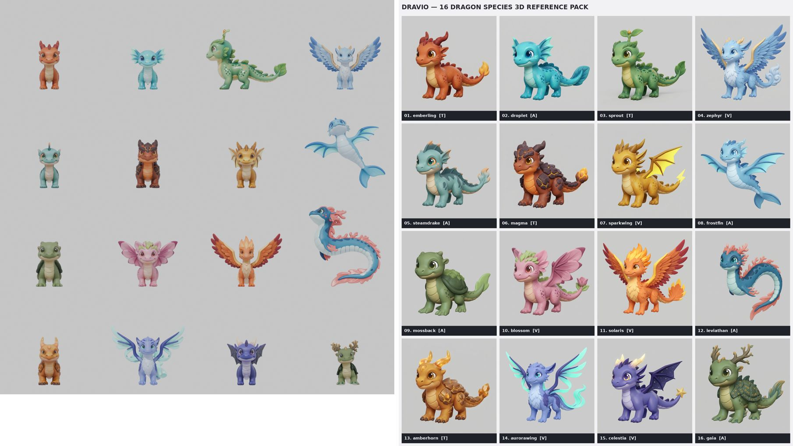
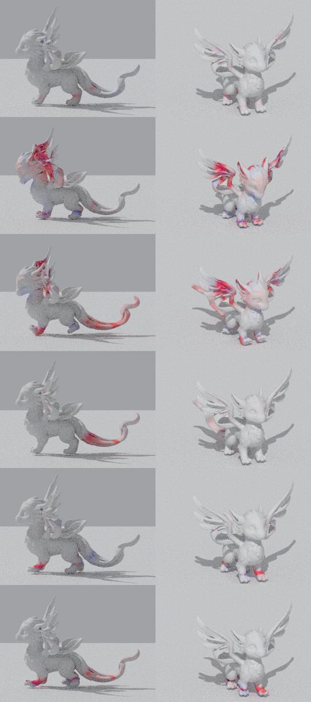
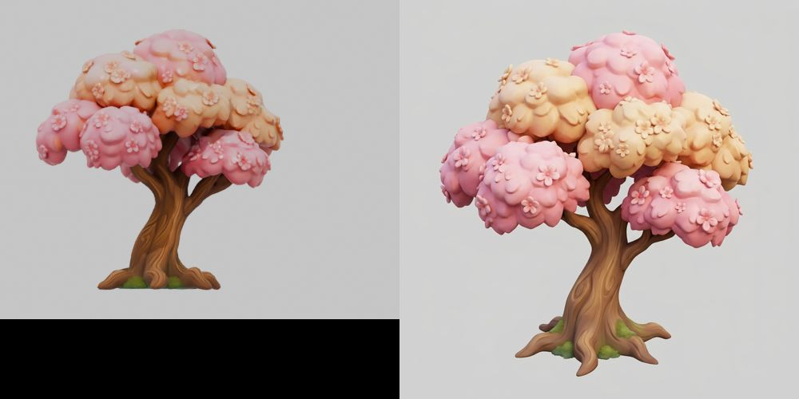

# CHAR.8 production: 16 GLB rồng thật + cây Blossom Sky — báo cáo QA

Nguồn: nhánh `feat/art-source-packs`, commit `0561a42`, `ArtSource/manifest.json`. Pipeline `u1-char8-v2` (rig v7 = rig v6 + U1-CHAR.7/7b/8 + sửa đo chân CHAR.8). Hướng dẫn tích hợp Unity: [`Assets/Dravio/Character/PRODUCTION_ASSETS.md`](../../../Assets/Dravio/Character/PRODUCTION_ASSETS.md). Báo cáo máy sinh: [`reports_char8_production/`](reports_char8_production/).

## 0. Chạy thật / chưa chạy

| Hạng mục | Trạng thái |
|---|---|
| Xác minh SHA-256 + kích thước 59 tệp theo manifest | **Chạy thật**: 59/59 khớp, không tệp lạ ngoài manifest |
| Blender 5.3 (`bpy` 5.3.0): kiểm định nguồn, prepare, rig, 13–21 clip, LOD, QA animation mọi frame, validate | **Chạy thật** trên cả 16 GLB và cây |
| Hồi quy pipeline trên 8 rồng SAMPLE | **Chạy thật**: 8/8 PASS, 0 cảnh báo (không đổi so với trước) |
| Unity import, prefab, Animation Lab, thiết bị | **Chưa chạy** (không có Unity ở đây) |
| File nguồn | Không sửa: batch kiểm SHA-256 trước/sau, `source_unchanged` |

## 1. Kiểm định nguồn (16 rồng + cây)

| GLB | Tam giác | Đỉnh | Mảnh (sau hàn) | Cạnh biên (sau hàn) | UV dùng | Mặt UV lật | BaseColor | Roughness/Metallic | Normal map | Skin/anim |
|---|---|---|---|---|---|---|---|---|---|---|
| 13_amberhorn.glb | 40,000 | 24,926 | 1 | 0 | 0.57 | 44 % | image 2048 | image 2048 | constant | không |
| 14_aurorawing.glb | 40,000 | 27,842 | 5 | 0 | 0.51 | 48 % | image 2048 | image 2048 | constant | không |
| 10_blossom.glb | 40,000 | 25,876 | 1 | 0 | 0.62 | 46 % | image 2048 | image 2048 | constant | không |
| 15_celestia.glb | 40,000 | 25,572 | 1 | 0 | 0.60 | 37 % | image 2048 | image 2048 | constant | không |
| 02_droplet.glb | 40,000 | 24,776 | 1 | 0 | 0.59 | 37 % | image 2048 | image 2048 | constant | không |
| 01_emberling.glb | 40,000 | 25,201 | 1 | 0 | 0.63 | 39 % | image 2048 | image 2048 | constant | không |
| 08_frostfin.glb | 40,000 | 25,201 | 1 | 0 | 0.60 | 58 % | image 2048 | image 2048 | constant | không |
| 16_gaia.glb | 40,000 | 26,233 | 1 | 0 | 0.59 | 34 % | image 2048 | image 2048 | constant | không |
| 12_leviathan.glb | 40,000 | 26,671 | 1 | 0 | 0.58 | 42 % | image 2048 | image 2048 | constant | không |
| 06_magma.glb | 40,000 | 26,013 | 1 | 0 | 0.61 | 43 % | image 2048 | image 2048 | constant | không |
| 09_mossback.glb | 40,000 | 24,145 | 1 | 0 | 0.56 | 43 % | image 2048 | image 2048 | constant | không |
| 11_solaris.glb | 40,000 | 27,721 | 1 | 0 | 0.60 | 39 % | image 2048 | image 2048 | constant | không |
| 07_sparkwing.glb | 40,000 | 25,572 | 1 | 0 | 0.60 | 57 % | image 2048 | image 2048 | constant | không |
| 03_sprout.glb | 40,000 | 24,954 | 1 | 0 | 0.64 | 34 % | image 2048 | image 2048 | constant | không |
| 05_steamdrake.glb | 40,000 | 24,230 | 1 | 0 | 0.56 | 33 % | image 2048 | image 2048 | constant | không |
| 04_zephyr.glb | 40,000 | 27,817 | 1 | 0 | 0.58 | 40 % | image 2048 | image 2048 | constant | không |
| 02_tree_blossom_sky.glb | 40,000 | 28,388 | 4 | 0 | 0.58 | 47 % | image 2048 | image 2048 | constant | không |

- Mọi nguồn là lưới tam giác 40 000 mặt từ bộ sinh ảnh-ra-3D: đường nối UV/normal tách đỉnh (cạnh biên giả); sau khi hàn, 15/16 rồng là **một mảnh kín** (Aurorawing 5 mảnh: dải sáng rời), cây 4 mảnh.
- Texture 2048² BaseColor + Roughness/Metallic; **không có normal map** (nên 33–58 % mặt UV "lật chiều" không gây lỗi bóng; sẽ cần sửa nếu sau này bake normal map).
- Không có skin, không có animation, không có shape key mí mắt (nên không có chớp mắt bằng blend shape).
- **Hướng:** 15/16 nhìn về −Y theo quy ước pipeline; **Sprout quay ngang** → `files.03_sprout.yawOffset = 90` (đo bằng ảnh render, không phải luật sinh học).

## 2. Đối chiếu ảnh tham chiếu và Species Morphology

- Silhouette, màu, bộ phận khớp ảnh tham chiếu cho cả 16 loài.
- Đúng `SPECIES_MORPHOLOGY.md`: Frostfin không chân đi, vây như cánh (không bay); Leviathan thân dài không chi; 14 loài còn lại 4 chân (pipeline đo được 4 chân độ tin cậy cao ở cả 14, kể cả 11 loài mà dữ liệu canonical chưa ghi số chân → ghi chú "art director xác nhận").
- Steamdrake: BodyStyle Serpent nhưng có 4 chân ngắn → archetype serpentine có chân (đúng silhouette "chi ngắn").
- Không giai đoạn nào được tách: mọi GLB là `Unstaged` (một model dùng cho cả ba giai đoạn cho tới khi có model theo giai đoạn).

## 3. Sửa pipeline để model thật rig được

Lượt đầu chỉ 0/14 loài đi bộ rig được: phép đo chân trả "0 chân". Nguyên nhân và sửa (`rig_geometry.detect_limbs`):

| Nguyên nhân (đo trên model thật) | Sửa |
|---|---|
| Dáng chibi: hai chân trước đứng sát nhau (khe 6 cm) → một cụm vắt qua đường giữa, bị coi là bụng | tách cụm vắt qua đường giữa **khi có khe trống thật** (không đỉnh nào) ở giữa |
| Sải cánh lớn làm ô lưới thô → cả hai cặp chân dính (Zephyr) | như trên |
| Chóp đuôi chạm đất ngoài đường giữa (Gaia) | khi số tiếp xúc lẻ hoặc > 4: bỏ cụm nhỏ < 35 % cụm lớn nhất |
| Model lệch tâm ~5 cm (Gaia) | xét đối xứng quanh đường giữa của chính các bàn chân |

Kết quả: 16/16 rig được. Mẫu SAMPLE cũ không đổi (8/8 PASS, 0 cảnh báo).

## 4. QA animation trên model thật (ngưỡng không đổi)

| Model | Archetype | Chân | Clip | Bone | LOD tris | Clip vượt giãn 1,6 | Giãn lớn nhất (clip) | Xương / vùng chính | Khác |
|---|---|---|---|---|---|---|---|---|---|
| DRG_amberhorn_Unstaged | quadruped | 4 | 19 | 26 | 24000/10000/4000 | 12/19 | 3.394 (Burrow) | Spine / body 22 % | ground 3 |
| DRG_aurorawing_Unstaged | winged | 4 | 19 | 32 | 23999/10000/4000 | 12/19 | 2.938 (Sleep) | Spine / body 22 % | bones 1 |
| DRG_blossom_Unstaged | winged | 4 | 20 | 32 | 24000/9999/4000 | 14/20 | 3.084 (Run) | Pelvis / body 40 % | bones 1, ground 2 |
| DRG_celestia_Unstaged | winged | 4 | 19 | 32 | 24000/10000/4000 | 13/19 | 5.309 (Run) | Pelvis / body 42 % | bones 1, ground 2 |
| DRG_droplet_Unstaged | quadruped | 4 | 21 | 28 | 24000/10000/4000 | 14/21 | 4.401 (Run) | Pelvis / body 35 % | — |
| DRG_emberling_Unstaged | quadruped | 4 | 15 | 26 | 24000/9999/4000 | 9/15 | 3.439 (Run) | Pelvis / body 50 % | — |
| DRG_frostfin_Unstaged | aquatic | 0 | 13 | 17 | 24000/9999/3999 | 8/13 | 3.095 (Happy) | Spine4 / body 39 % | bones 1 |
| DRG_gaia_Unstaged | quadruped | 4 | 21 | 27 | 24000/10000/4000 | 16/21 | 13.437 (Swim) | Pelvis / body 78 % | bones 1, ground 1 |
| DRG_leviathan_Unstaged | serpentine | 0 | 13 | 19 | 24000/9999/4000 | 9/13 | 8.475 (Sleep) | Spine8 / body 35 % | — |
| DRG_magma_Unstaged | quadruped | 4 | 19 | 26 | 24000/9999/3999 | 12/19 | 3.53 (Run) | Pelvis / body 28 % | bones 1 |
| DRG_mossback_Unstaged | quadruped | 4 | 21 | 26 | 24000/10000/4000 | 15/21 | 10.983 (Swim) | Pelvis / body 66 % | — |
| DRG_solaris_Unstaged | winged | 4 | 19 | 32 | 24000/10000/4000 | 11/19 | 2.368 (Sleep) | Spine / body 25 % | ground 3, facing 1 |
| DRG_sparkwing_Unstaged | winged | 4 | 19 | 32 | 24000/10000/4000 | 14/19 | 6.145 (Run) | Pelvis / body 27 % | ground 2 |
| DRG_sprout_Unstaged | quadruped | 4 | 19 | 26 | 24000/9999/4000 | 14/19 | 4.401 (Run) | Pelvis / body 32 % | — |
| DRG_steamdrake_Unstaged | serpentine | 4 | 21 | 31 | 24000/10000/4000 | 14/21 | 4.359 (Swim) | Spine3 / body 43 % | — |
| DRG_zephyr_Unstaged | winged | 4 | 20 | 32 | 24000/10000/4000 | 8/20 | 1.972 (Glide) | Spine / body 28 % | bones 1, footSliding 1, ground 4, facing 1 |

**Kết luận thẳng thắn:** hình học, UV, texture, LOD và bộ khung đều qua kiểm định; **animation chưa đạt** — 8–16 clip mỗi model vượt ngưỡng giãn cạnh 1,6 (Idle, Greet, Nuzzle, LookAround, Curious phần lớn đạt). Không nới ngưỡng.

Nguyên nhân hệ thống (tổng hợp vùng gây giãn trên 16 model): **thân / xương Pelvis 67 %**, chân sau 13 %, cổ 7 %, đuôi 6 %. Lỗi nằm ở **phân vùng chân–thân** của rig tự động trên dáng chibi (chân ngắn, mập, mọc sát bụng): một phần đỉnh chân và bụng sát chân được gán cho Pelvis/Spine, nên khi chân gập (Sleep, Rest, Bask, Run, Swim) cạnh nối bị kéo dài. Thí nghiệm nới dải chuyển tiếp thân–chân theo mét (`DRAVIO_LEG_BAND_REL`, mặc định tắt) trên Emberling: Run 3,44 → 2,74, Walk 2,18 → 1,82, nhưng Sleep/Bask không đổi → **không phải giải pháp đủ**, nên không bật.

Thứ tự sửa đề xuất (để PASS thật, không nới ngưỡng):
1. Phân vùng chân bằng khoảng cách trắc địa từ bàn chân tới gốc chân (thay cho lát cắt theo trục), có giới hạn theo cao độ bụng — đúng cho dáng chibi.
2. Giảm biên độ gập chân của Sleep/Rest/Bask/Run theo tỉ lệ chiều dài chân / chiều cao thân (chân chibi ngắn không gập được như mẫu).
3. Gaia, Mossback Swim (giãn 11–13): mai/giáp cứng phải theo Spine/Chest, không theo Pelvis; cần landmark mai (`files.<stem>.landmarks`) hoặc vùng "shell".
4. Leviathan Sleep (8,5): biên độ cuộn thân quá lớn so với thân dày; giảm theo tỉ lệ dày/dài.
5. Sau đó chỉnh tay trong Blender cho từng loài (art director duyệt trong Animation Lab).

## 5. Aurorawing thật (phần thưởng thám hiểm Thiên Giới)

`14_aurorawing.glb` → `DRG_aurorawing_Unstaged`: winged, 4 chân (đo được), 32 bone, 19 clip (không Swim/Burrow/Perch, đúng sinh học), LOD 23 999 / 10 000 / 4 000. Khớp ảnh tham chiếu (cánh dải sáng, lông cổ, đuôi cực quang). QA: 12/19 clip vượt giãn (lớn nhất 2,94 ở Sleep, Spine 22 %) — cùng nhóm lỗi mục 4; mức nhẹ nhất nhóm winged sau Zephyr. Model thật **thay cho blockout SAMPLE** của PR #65 (blockout chỉ còn giá trị tham khảo tỉ lệ ba giai đoạn).

## 6. Cây Blossom Sky

`02_tree_blossom_sky.glb` → prop `tree` (`prop_large`): khớp ảnh tham chiếu (tán hồng–kem, thân cong, rễ), LOD 10 000 / 4 000 / 1 200 (đúng ngân sách), collider mesh tĩnh 1 000 tam giác, pivot đáy giữa, cao 1,96 đơn vị nguồn (chưa có chiều cao thật, `sizeConfirmed = false`). Validation **PASS_WITH_WARNINGS**: LOD0 còn 1 199 đỉnh rời và 11 186 cạnh biên sau decimate (nguồn sau khi hàn là kín, 4 mảnh → nhánh prop cần hàn đường nối trước khi giảm, chưa sửa), 46–49 % mặt UV lật (vô hại khi không có normal map), texture 2048² (khuyến nghị 1024², importer Unity giảm khi build mobile).

## 7. Concept sinh cảnh và vật thể

7 concept sinh cảnh + 16 vật thể (4 hero prop, 12 nature/gameplay) dùng làm chuẩn nghệ thuật: đá cổ khối dày phủ rêu, dây leo có hoa, rune phát sáng xanh lam, ánh vàng ấm (Khởi Nguyên); nước ngọc, san hô hồng–ngọc, tinh thể băng (Thủy Vực); pastel, mây, cây hoa (Thiên Giới). Ba mẫu Sanctuary đã được chỉnh theo hướng này (rêu, dây thường xuân + hoa, rune phát sáng). 15/16 vật thể mới chỉ có ảnh (chưa có GLB) — cần sinh 3D trước khi đưa vào pipeline prop.

## 8. Hiệu năng (ước tính, chưa đo thiết bị)

Như `reports_char8_production/performance-budget.md`: mỗi rồng LOD0 24 000 tam giác, 17–32 bone, 1 material, texture 1024² (đã giảm từ 2048² nguồn); 30 rồng ≈ 318 000 tam giác vẽ. Gói Unity sinh ra 278 MB (FBX 74 MB, texture ~115 MB, ảnh QA 89 MB) — **không commit**, tái tạo bằng lệnh ở `PRODUCTION_ASSETS.md`.
